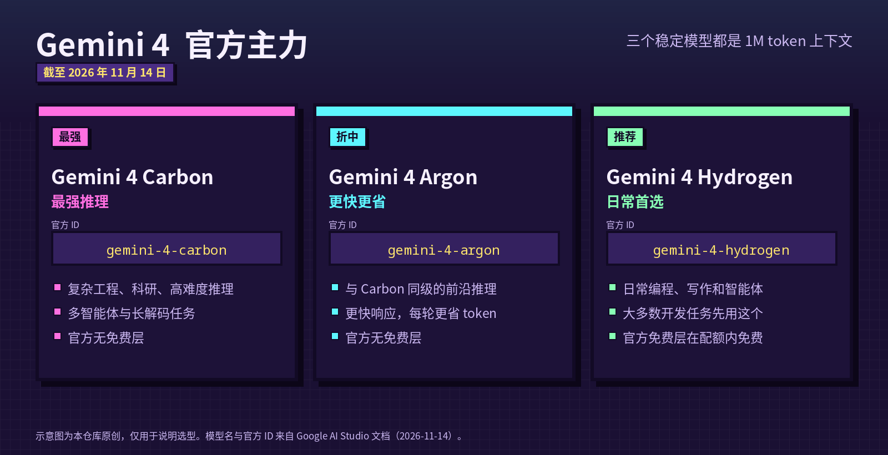
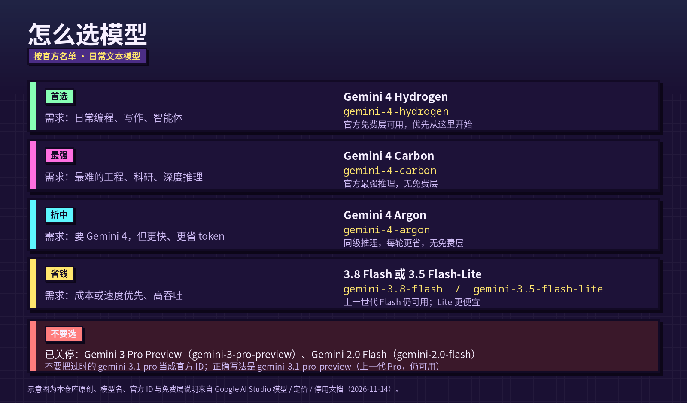

# Gemini 4 国内使用完全指南：5种方式，总有一种适合你

截至 2026 年 11 月 14 日，Google 官方最新一代是 **Gemini 4**，三个稳定模型都已在 Gemini API 上线：最强推理是 **Gemini 4 Carbon**（`gemini-4-carbon`，11 月 10 日发布），同级但更快、每轮更省 token 的是 **Gemini 4 Argon**（`gemini-4-argon`，10 月 13 日发布），日常编程和智能体优先用 **Gemini 4 Hydrogen**（`gemini-4-hydrogen`，11 月 12 日发布，官方免费层可用）。三个模型都是 100 万 token 上下文。

上一世代里，**Gemini 3.8 Flash** 仍是主力 Flash，高吞吐用 **Gemini 3.5 Flash-Lite**；**Gemini 3.1 Pro Preview** 仍可用，但官方 ID 是 `gemini-3.1-pro-preview`，不再是这篇指南原先写的最新旗舰。**Gemini 3 Pro Preview**（`gemini-3-pro-preview`）和 **Gemini 2.0 Flash** 已关停；**Gemini 2.5 Pro / 2.5 Flash** 已弃用，并将从 2026 年 12 月 1 日起分别自动转到 `gemini-3.8-flash` / `gemini-3.5-flash-lite`。

下面的 5 种国内使用方式没有变，变的是你该选哪个模型。

资料来源：[官方模型列表](https://aistudio.google.com/docs/models)、[定价](https://aistudio.google.com/docs/pricing)、[停用说明](https://aistudio.google.com/docs/deprecations)。



*示意图为本仓库原创，仅用于说明选型。模型名与官方 ID 来自 [Google AI Studio 模型文档](https://aistudio.google.com/docs/models)（2026-11-14）。*

## 国内直连三入口（速查）

不想看长文？先收藏这三个：

| 场景 | 入口 | 说明 |
|------|------|------|
| API / 开发接入 | https://tryallapi.com/ | 国内 API 中转（MomoAPI），按量调用 Gemini |
| 网页日常对话 | https://trygpt.asia/list/#/home | 镜像站，注册即聊，无需魔法 |
| 多模型一站聊 | http://trymodel.chat/ | Gemini + ChatGPT + Claude + Grok 聚合 |

## 最新官方模型速查

按 2026 年 11 月 14 日的官方文档整理，只列日常最常用的文本模型。价格为 Gemini Developer API 付费层、每 100 万 tokens 的 Standard 标价；输出价格含思考（thinking）tokens。Carbon / Argon 的促销价到 2026 年 11 月 30 日截止。



*示意图为本仓库原创。选型说明与官方 ID 来自 Google AI Studio 模型、定价和停用文档（2026-11-14）。*

| 模型 | 官方 ID | 适合做什么 | 付费层输入 / 输出 | 备注 |
|------|---------|------------|-------------------|------|
| Gemini 4 Carbon | `gemini-4-carbon` | 复杂工程、科研、高难度推理、多智能体 | $2 / $10（12 月 1 日起 $4 / $20） | 官方最强；无免费层 |
| Gemini 4 Argon | `gemini-4-argon` | 同级推理，但更快、每轮更省 token | $2 / $10（12 月 1 日起 $4 / $20） | 无免费层 |
| Gemini 4 Hydrogen | `gemini-4-hydrogen` | 日常编程、智能体、大多数开发任务 | $1.50 / $7.50 | 官方免费层在配额内免费，优先推荐 |
| Gemini 3.8 Flash | `gemini-3.8-flash` | 上一世代主力 Flash，长程工程和智能体 | $0.75 / $3.75（2027 年 1 月 1 日起 $1.50 / $7.50） | 免费层在配额内免费 |
| Gemini 3.5 Flash-Lite | `gemini-3.5-flash-lite` | 高吞吐、成本优先 | $0.30 / $2.50 | 2.5 Flash 将在 12 月 1 日转到此模型 |
| Gemini 3.1 Pro Preview | `gemini-3.1-pro-preview` | 仍可用的上一代 Pro | $2 / $12（提示 ≤20 万 tokens）；更长上下文 $4 / $18 | 不是最新旗舰；不要写成 `gemini-3.1-pro` |

已关停、不要再选：`gemini-3-pro-preview`（Gemini 3 Pro Preview）、`gemini-2.0-flash`。图片生成看 Nano Banana 2.1（`gemini-nano-banana-2.1`），实时语音看 Gemini 3.8 Live（`gemini-3.8-live`），这些是另一条线，不是对话主力。

下面是完整 5 种方式详解（含官方与订阅路径）。

## 方式一：镜像站（推荐）

这是最简单的方式，也是我自己在用的。

### 优点

✅ 完全免费，无需付费
✅ 国内直连，不用魔法上网
✅ 注册即用，限时免费
✅ 界面和官方一样
✅ 访问速度快
✅ 支持所有 Gemini 模型

### 怎么用

**第一步：访问镜像站**

- 地址 1：https://trygpt.asia/list/#/home（推荐）
- 地址 2：https://gemini-ultra.top/list/#/home（备用）


**第二步：注册账号**

- 点击注册按钮
- 填写邮箱和密码
- 验证邮箱
- 完成注册

**第三步：选择模型**

注册后，按官方最新名单优先选：
- Gemini 4 Hydrogen（日常默认，推荐先用这个）
- Gemini 4 Argon（要更快、更省 token 的 Gemini 4）
- Gemini 4 Carbon（最强推理）
- Gemini 3.8 Flash（上一世代主力 Flash）
- Gemini 3.5 Flash-Lite（高吞吐、更便宜）

不要再选已关停的 Gemini 3 Pro Preview、Gemini 2.0 Flash。若平台仍列出 Gemini 3.1 Pro，对应官方 ID 是 `gemini-3.1-pro-preview`，它还在，但已不是最新旗舰。

**第四步：开始使用**

直接在网页里对话，和 ChatGPT 一样简单。

### 适合谁

- 普通用户：只想简单用用
- 学生：预算有限
- 开发者：快速测试
- 内容创作者：写文章、做视频

### 成本

完全免费。

我用了一周，做了这些事：
- 写代码：10个项目
- 写文章：20篇
- 数据分析：5个报告
- 3D建模：3个模型

总成本：¥0

如果用官方 API，至少要花 ¥500。

### 注意事项

- 限时免费，建议尽早注册
- 注册后即可使用，无需等待
- 支持所有功能，和官方一样

## 方式二：ChatGPT Plus 镜像站

除了 Gemini 专用镜像站，还有一个更强大的选择。

### 优点

✅ 一站式服务，支持多个 AI 模型
✅ 包含 Gemini、ChatGPT、Claude 等
✅ 国内直连，无需魔法上网
✅ 价格实惠，按需充值
✅ 界面友好，操作简单

### 怎么用

**第一步：访问平台**

地址：https://chatgpt-plus.top/list/#/home

也可试用多模型聚合站：http://trymodel.chat/（Gemini / ChatGPT / Claude / Grok 一站聊）

**第二步：注册账号**

- 点击注册
- 填写邮箱和密码
- 完成验证

**第三步：充值使用**

- 支持支付宝、微信支付
- 按需充值，用多少充多少
- 价格比官方便宜很多

**第四步：选择模型**

可以使用：
- Gemini 4 Hydrogen / Argon / Carbon（以平台实际列出的官方模型名为准）
- ChatGPT、Claude 等其他主流模型
- 其他主流 AI 模型

### 适合谁

- 需要多个 AI 模型的用户
- 想一站式解决的用户
- 预算有限但需要稳定服务
- 不想折腾的用户

### 成本

按使用量付费，比官方便宜 50-70%。

参考价格：
- 充值 ¥100，可以用很久
- 比官方订阅省钱
- 用多少充多少，不浪费

### 注意事项

- 需要充值才能使用
- 支持国内支付方式
- 多个模型可以切换使用

## 方式三：Google AI Studio（官方免费）

Google 官方提供的免费开发平台，很多人不知道。

### 优点

✅ 完全免费（有配额限制）
✅ 官方服务，稳定可靠
✅ 支持 API 和网页使用
✅ 适合开发测试

### 缺点

❌ 需要魔法上网
❌ 每天有使用配额限制
❌ 需要 Google 账号

### 怎么用

**第一步：访问 AI Studio**

地址：https://aistudio.google.com

**第二步：登录 Google 账号**

- 使用你的 Google 账号登录
- 如果没有，需要先注册

**第三步：开始使用**

有两种方式：

**方式 A：网页对话**
- 直接在网页里对话
- 和 ChatGPT 一样简单
- 免费使用

**方式 B：获取 API Key**
- 点击 "Get API Key"
- 创建新的 API Key
- 在代码中调用

### 适合谁

- 开发者：测试和开发
- 学生：学习 AI 开发
- 轻度用户：偶尔使用
- 想试用官方服务的用户

### 成本

完全免费，但有限制：

- 每天有请求次数限制
- 每分钟有调用频率限制
- 适合轻度使用

### 注意事项

- 需要魔法上网
- 有使用配额限制
- 超出配额需要付费

## 方式四：官方订阅

如果你想用官方完整服务，也可以。

### 优点

✅ 官方服务，稳定可靠
✅ 数据隐私有保障
✅ 支持最新功能
✅ 无使用限制

### 缺点

❌ 需要魔法上网
❌ 需要外币信用卡
❌ 月费 $20（约 ¥144）
❌ 注册流程复杂

### 怎么用

**第一步：准备工具**

- 魔法上网工具
- 外币信用卡（Visa/MasterCard）
- Google 账号

**第二步：访问 Gemini 官网**

访问 Gemini 官网（需要魔法上网）。

**第三步：订阅 Ultra**

- 选择 Google AI Ultra 订阅
- 填写信用卡信息
- 确认订阅

**第四步：开始使用**

订阅后，可以在 Gemini 应用中使用所有模型。

### 适合谁

- 企业用户：需要官方支持
- 对隐私要求高的用户
- 有外币信用卡的用户
- 不差钱的用户

### 成本

- 月费：$20（约 ¥144）
- 年费：$240（约 ¥1,728）

### 注意事项

- 需要持续付费
- 取消订阅后无法使用
- 需要稳定的魔法上网

## 方式五：API 调用（开发者）

如果你是开发者，想在代码中调用，可以用 API。

### 优点

✅ 灵活性高
✅ 可以集成到自己的应用
✅ 按需付费

### 缺点

❌ 需要编程知识
❌ 需要付费（按使用量）
❌ 配置相对复杂

### 怎么用

**第一步：获取 API Key**

有两种方式：

**方式 A：官方 API**
- 访问 Google AI Studio
- 创建 API Key
- 需要魔法上网和外币卡

**方式 B：第三方 API（推荐）**
- 使用国内的 API 中转服务
- 价格更便宜
- 不需要魔法上网
- 推荐中转站：https://tryallapi.com/

**第二步：配置代码**

以 Python 为例：

```python
import google.generativeai as genai

# 配置 API Key
genai.configure(api_key='your-api-key')

# 创建模型（日常推荐 Hydrogen；最强推理改用 gemini-4-carbon）
model = genai.GenerativeModel('gemini-4-hydrogen')

# 生成内容
response = model.generate_content('Hello!')
print(response.text)
```

**第三步：调用 API**

在代码中调用，就像调用函数一样简单。

### 适合谁

- 开发者：需要集成到应用
- 企业：需要批量处理
- 高级用户：需要自动化

### 成本

官方 API 价格（Gemini Developer API 付费层、Standard，每 100 万 tokens；输出含思考 tokens）：

| 模型 | 输入价格 | 输出价格 | 说明 |
|------|---------|---------|------|
| Gemini 4 Carbon / Argon | $2（至 2026-11-30），此后 $4 | $10，此后 $20 | 无免费层 |
| Gemini 4 Hydrogen | $1.50 | $7.50 | 免费层在配额内免费 |
| Gemini 3.8 Flash | $0.75（至 2026-12-31），此后 $1.50 | $3.75，此后 $7.50 | 免费层在配额内免费 |
| Gemini 3.1 Pro Preview | $2 / $4（提示 ≤20 万 / >20 万 tokens） | $12 / $18 | 上一代 Pro，仍可用 |

完整价目以官方定价页为准：https://aistudio.google.com/docs/pricing

**第三方 API 价格**：

通常比官方便宜 50-80%。

### 注意事项

- 需要编程知识
- 注意 API 调用限制
- 做好错误处理

## 五种方式对比

| 维度 | 镜像站 | ChatGPT Plus镜像 | AI Studio | 官方订阅 | API 调用 |
|-----|--------|-----------------|-----------|---------|---------|
| 难度 | ⭐ | ⭐ | ⭐⭐ | ⭐⭐⭐ | ⭐⭐⭐⭐ |
| 成本 | 免费 | 按量付费 | 免费（有限额） | $20/月 | 按量付费 |
| 魔法上网 | 不需要 | 不需要 | 需要 | 需要 | 需要（官方） |
| 外币卡 | 不需要 | 不需要 | 不需要 | 需要 | 需要（官方） |
| 速度 | 快 | 快 | 中等 | 中等 | 快 |
| 稳定性 | 高 | 高 | 高 | 高 | 高 |
| 模型支持 | Gemini全系列 | 多个AI模型 | Gemini全系列 | Gemini全系列 | Gemini全系列 |
| 适合人群 | 所有人 | 需要多模型用户 | 开发者/学生 | 企业/高端用户 | 开发者 |

## 我的推荐

根据不同需求，我的推荐：

### 如果你是普通用户

**推荐：镜像站（方式一）**

理由：
- 完全免费
- 不用魔法上网
- 注册即用
- 功能完整

### 如果你需要多个 AI 模型

**推荐：ChatGPT Plus 镜像站（方式二）**

理由：
- 一站式服务
- 支持 Gemini、ChatGPT、Claude
- 价格实惠
- 国内直连

### 如果你是学生或开发者

**推荐：Google AI Studio（方式三）**

理由：
- 完全免费
- 官方服务
- 适合学习和测试
- 可以获取 API Key

### 如果你是企业用户

**推荐：官方订阅（方式四）**

理由：
- 官方支持
- 数据隐私有保障
- 稳定可靠
- 无使用限制

### 如果你是专业开发者

**推荐：API 调用（方式五）**

理由：
- 灵活性高
- 可以集成到应用
- 按需付费
- 适合生产环境

### 如果你预算有限

**推荐：镜像站（方式一）或 AI Studio（方式三）**

理由：
- 完全免费
- 功能和官方一样
- 无需付费

## 常见问题

### Q1：镜像站安全吗？

A：安全。镜像站只是提供访问通道，不存储你的数据。

### Q2：镜像站会一直免费吗？

A：目前是限时免费，建议尽早注册。

### Q3：镜像站和官方有什么区别？

A：功能完全一样，只是访问方式不同。

### Q4：可以同时用多种方式吗？

A：可以。我自己就是镜像站 + API 一起用。

### Q5：哪种方式最省钱？

A：镜像站，完全免费。

### Q6：哪种方式最稳定？

A：官方订阅，但需要付费。

### Q7：开发者应该选哪种？

A：如果只是测试，用镜像站或 AI Studio。如果要集成到应用，用 API。

### Q8：镜像站支持所有模型吗？

A：主流镜像站通常会跟官方模型更新，但要以页面实际可选名单为准。当前官方主力是 Gemini 4 Hydrogen / Argon / Carbon，以及 3.8 Flash、3.5 Flash-Lite。已关停的 3 Pro Preview、2.0 Flash 不应再作为可选项。

### Q9：ChatGPT Plus 镜像站和 Gemini 镜像站有什么区别？

A：ChatGPT Plus 镜像站支持多个 AI 模型，Gemini 镜像站只支持 Gemini 系列。

### Q10：AI Studio 的免费配额够用吗？

A：对于轻度使用和测试够用，重度使用建议选择其他方式。

## 使用技巧

### 技巧1：选对模型

不同任务，用不同模型：

- **Gemini 4 Hydrogen**：日常编程、写作、智能体，多数情况先用这个
- **Gemini 4 Argon**：复杂任务里想要比 Carbon 更快、更省 token
- **Gemini 4 Carbon**：最难的工程、科研和深度推理
- **Gemini 3.8 Flash / 3.5 Flash-Lite**：成本和速度优先，或高吞吐场景

### 技巧2：优化 Prompt

好的 Prompt，效果更好：

❌ 不好的 Prompt：
```
帮我写代码
```

✅ 好的 Prompt：
```
用 Python 写一个数据分析工具：
- 读取 CSV 文件
- 支持多种统计分析
- 生成可视化图表
- 导出 PDF 报告
```

### 技巧3：分步骤

复杂任务，分成多个步骤：

1. 先让 AI 理解需求
2. 再让 AI 设计方案
3. 最后让 AI 实现

### 技巧4：多试几次

如果结果不满意，换个说法再试。

### 技巧5：保存好的 Prompt

遇到好用的 Prompt，保存下来，下次直接用。

## 立即开始

### 方式一：Gemini 镜像站（推荐）

访问：https://trygpt.asia/list/#/home  
备用：https://gemini-ultra.top/list/#/home

- 注册账号
- 选择模型
- 开始使用

### 方式二：ChatGPT Plus 镜像站

访问：https://chatgpt-plus.top/list/#/home

- 注册账号
- 充值使用
- 支持多个 AI 模型

### 方式三：Google AI Studio

访问：https://aistudio.google.com

- 登录 Google 账号
- 免费使用（有配额）
- 适合开发测试

### 方式四：官方订阅

访问 Gemini 官网

- 订阅 Ultra
- 开始使用

### 方式五：API 调用

获取 API Key，在代码中调用。

## 总结

官方主力已经换成 Gemini 4：日常和开发优先 **Hydrogen**，要最强推理用 **Carbon**，要在质量和成本之间折中用 **Argon**。成本和速度优先可以继续用 **3.8 Flash** 或 **3.5 Flash-Lite**。不要再用已关停的 **2.0 Flash**、**3 Pro Preview**，也不要把旧的 `gemini-3.1-pro` 当成官方模型 ID。

国内使用路径还是这 5 种：

1. **Gemini 镜像站**：最简单，完全免费，推荐所有人
2. **ChatGPT Plus 镜像站**：一站式服务，支持多个 AI 模型
3. **Google AI Studio**：官方免费，适合开发测试（Hydrogen、3.8 Flash 等在官方免费层配额内可用；Carbon / Argon 官方无免费层）
4. **官方订阅**：最稳定，需要付费，适合企业
5. **API 调用**：最灵活，按量付费，适合开发者；请使用官方 ID，例如 `gemini-4-hydrogen`

我自己用的是 Gemini 镜像站，因为：
- 完全免费
- 不用魔法上网
- 功能完整
- 速度快

如果你还没试过 Gemini 4，建议从 Gemini 镜像站开始，先选 Hydrogen。

注册即用，限时免费。

---

**Gemini 镜像站**：https://trygpt.asia/list/#/home  
**备用镜像**：https://gemini-ultra.top/list/#/home  
**多模型聚合**：http://trymodel.chat/  
**API 中转**：https://tryallapi.com/  
**ChatGPT Plus 镜像站**：https://chatgpt-plus.top/list/#/home  
**Google AI Studio**：https://aistudio.google.com

**注册账号，限时免费，无需魔法上网。**
